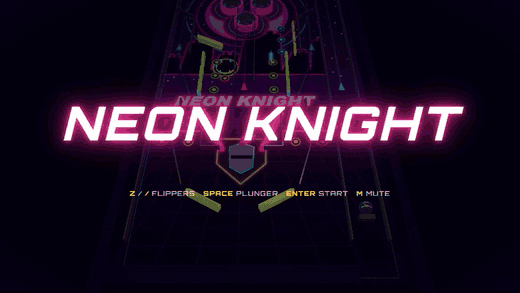

<div align="center">

# NEON KNIGHT

**A retro 70s/80s arcade pinball table that runs in your browser.**
One original table, a hand-written physics solver, and a synthwave coat of neon.



TypeScript · Vite · three.js · procedural WebAudio · zero image or audio assets for gameplay

</div>

---

## Why this exists

Most browser pinball games get the _look_ right and the _feel_ wrong. Neon Knight flips that priority.
The physics are a custom 2D solver written from scratch for a tilted playfield, and everything else
(rules, rendering, audio) is built around it.

- **Swept (continuous) collision**: the ball never tunnels, even at plunger speed.
- **Flippers are rotating capsules** whose angular velocity feeds the collision response, so a flick
  into the ball on the tip is a hard shot and a dead-catch on the base is a soft one.
- **Fixed 1000 Hz timestep**, decoupled from rendering and deterministic: identical inputs give
  identical ball paths, so the whole simulation is unit-tested headless.
- **Variable plunger**: hold to pull back, release to launch. A harder pull exits the arch faster.
- **Nudge and tilt**: shove the table to save a ball, shove it too often and it tilts.

## Play

```bash
npm install
npm run dev        # http://localhost:5173
```

| Action        | Keyboard                          | Gamepad               | Touch                      |
| ------------- | --------------------------------- | --------------------- | -------------------------- |
| Start         | `Enter`                           | Start                 | Top strip, left third      |
| Plunger       | `Space` or `Down` (hold, release) | A or D-pad down       | Top strip, remaining width |
| Left flipper  | `Z`, `Left` or `Shift`            | LB, LT or D-pad left  | Lower screen, left half    |
| Right flipper | `/`, `Right` or `Shift`           | RB, RT or D-pad right | Lower screen, right half   |
| Nudge         | -                                 | -                     | Tilt or shake the device   |
| Mute          | `M`                               | -                     | Sound button               |

## The table

Layout and shot flow borrow from the classic two-level tables of 1980 (only the geometry; the name,
theme, artwork and text are original):

- **Plunger lane and arch** that carries a launched ball over the top
- **Three pop bumpers** in a triangle cluster on the upper playfield
- **Upper flipper** for the left orbit and bumper cluster
- **A-B-C rollovers** under the arch: complete them for a bonus-multiplier jump
- **Two drop-target banks** of three, a **standup target bank**, and a **spinner**
- **Kickout saucer** that locks balls for **multiball**
- **Left and right orbits** plus a **centre ramp**, all with chainable combos
- **Slingshots, inlanes and outlanes** guarding the two main flippers
- **Missions** (_Bumper Rush_, _Spin Cycle_, _Sling Shot_) leading to a **wizard mode**
- End-of-ball **bonus** with a multiplier up to 5x, extra ball from repeated ramp shots
- A **dot-matrix display** for callouts, **attract mode**, and a persistent **high-score table**

Audio is generated live with WebAudio (effects and music); there are no audio files to download.

## Architecture

```
src/
├── core/      fixed-timestep loop, lamps, events, attract mode, high scores
├── physics/   custom 2D swept-collision solver (headless, deterministic, no three.js)
├── rules/     state machine: scoring, missions, multiball, ball save, tilt, bonus
├── table/     typed table definition shared by physics and rendering
├── render/    three.js scene, procedural artwork, DMD, post-processing
├── input/     keyboard, touch, gamepad, accelerometer -> abstract actions
└── audio/     procedural WebAudio sfx and music
```

The key boundaries:

- The **simulation never imports three.js**, so it runs in plain Vitest.
- The **rules engine consumes physics events** (bumper hit, drain, ...) and emits commands
  (add ball, light lamp, play sound). It never touches physics directly.
- The **input layer** reduces every device to the same handful of abstract actions.

## History

Neon Knight was built in phases, each one leaving the game playable:

1. **Feel sandbox**: the solver, flippers, plunger, bumpers and a live tuning panel. Nothing else
   until the ball felt right.
2. **Table layout and three.js scene**: a full-size table (about 19 ball diameters wide, 40 tall) replacing
   the half-scale "Neon Orbit" prototype, with upper flipper, drop banks, saucer, orbits and ramp.
3. **Rules and scoring**: the state machine, missions, combos, multiball and wizard mode.
4. **Presentation**: the dot-matrix display, procedural WebAudio sound and music, attract mode.
5. **Platform polish**: touch controls, accelerometer nudge, gamepad support, high scores, and
   deployment to GitHub Pages.

Most of the code was written in autonomous "Ralph Wiggum" loops: fresh-context iterations that each
pick one task from [`IMPLEMENTATION_PLAN.md`](IMPLEMENTATION_PLAN.md), implement it against the specs in
[`specs/`](specs), and commit. The specs are the source of truth:
[`physics-feel`](specs/physics-feel.md), [`table-layout`](specs/table-layout.md),
[`table-neon-knight`](specs/table-neon-knight.md), [`game-rules`](specs/game-rules.md) and
[`presentation`](specs/presentation.md).

The pinball lineage it salutes goes back further: flippers arrived in 1947, solid-state electronics and
multiball took over in the late 70s and 80s, and the dot-matrix display followed. Neon Knight is a love
letter to that era's table design.

## Development

| Command            | Description                             |
| ------------------ | --------------------------------------- |
| `npm run dev`      | Vite dev server                         |
| `npm run build`    | Typecheck + production build            |
| `npm run test:run` | Unit tests (Vitest)                     |
| `npm run test:e2e` | Playwright (mobile-chrome and chromium) |
| `npm run check`    | typecheck + lint + format check + knip  |

Husky runs lint-staged on commit. CI (`ci.yml`) runs typecheck, lint, format, knip, unit tests and
Playwright on every push and PR; `deploy.yml` publishes `dist/` to GitHub Pages from `main` (enable
Pages with source "GitHub Actions"). The build uses a relative base, so it works under any subpath.

Playwright visual baselines are per-platform. Committed baselines are `win32`; for Linux CI, run the
**Update Linux snapshots** workflow, download the `linux-snapshots` artifact, copy the PNGs into
`e2e/visual.spec.ts-snapshots/` and commit them.

## Credits

Design and code by Chris Brooksbank, with Claude. Orbitron typeface via Fontsource. Built with
[three.js](https://threejs.org/).
